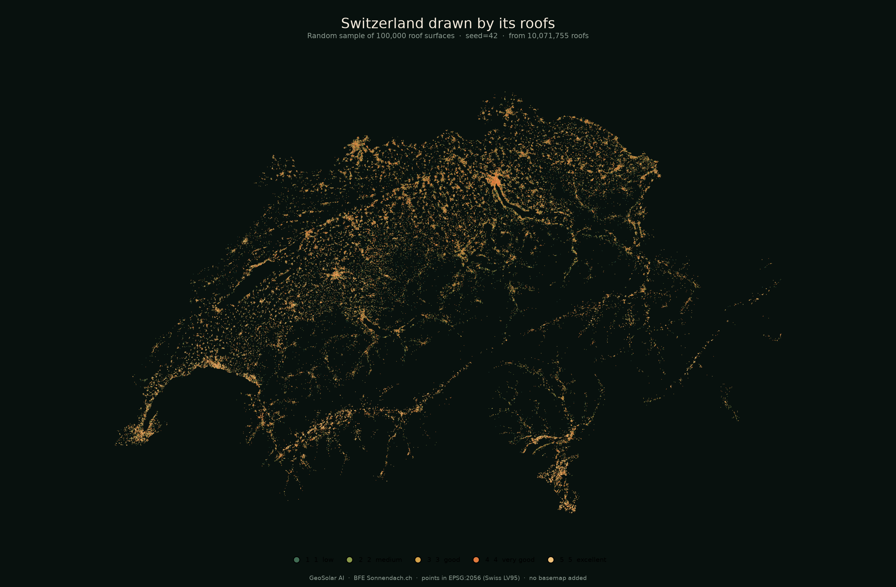

# GeoSolar AI

A dark map of Swiss rooftop solar: **hex neighbourhoods counted from the full 10,071,755-roof Sonnendach.ch cadastre**, plus an **each-roof** view of 100,000 official MultiPoints. Interface in English, German, French, and Italian.

The explorer is static JSON + Leaflet. No live API, no kWh forecast.



## Open

**https://alexanderduckworthhu.github.io/geosolar-ai/**

Links keep language, view, city, and search (`?lang=de&view=hex&city=zh`, or `?q=8001` / `?lat=&lon=`).

To run a local copy:

```bash
cd frontend
python3 -m http.server 8000
```

| Control | |
| --- | --- |
| **EN / DE / FR / IT** | Interface language |
| **Hex 2.4 km / Each roof** | Neighbourhood cells from the full cadastre, or one sampled roof MultiPoint |
| **Map / No map** | Satellite underlayer on or off |
| **Search / Locate** | Address, Swiss postcode, WGS84 or LV95, or the device location |
| **CH / city chips** | Jump to a city |
| **Class floor** | Dim cells or roofs below that class |
| **Mean class / Class 4–5** | Colour by average suitability or by share of excellent roofs |
| Hover / click | Preview, then pin |

Feature walkthrough: `visuals/explorer_demo.mp4`

## Data

[*Eignung von Hausdächern für die Nutzung von Sonnenenergie*](https://opendata.swiss/de/dataset/eignung-von-hausdachern-fur-die-nutzung-von-sonnenenergie) — BFE / swisstopo / MeteoSwiss.

Hexes are binned in EPSG:2056 (2.4 km), clipped to swissBOUNDARIES3D so they do not draw across Austria, Germany, or France, then drawn in WGS84. A cell on the Rhine can still sit against a simplified country line. The roof view plots a 100,000-roof sample of official coordinates — not the full 10 million points, which would be too heavy for the browser.

Rebuild maps:

```bash
python visuals/build_hex_explorer.py
python visuals/build_visuals.py --from-sample
python visuals/build_canton_map.py --from-cache
python visuals/build_demo.py
```

`build_hex_explorer.py` reads the full FileGDB when `data/raw/solarenergie-eignung-daecher_2056_generalized.gdb.zip` is present (`--from-sample` bins only the 100k CSV).

## Why not kWh

Official `KLASSE` is assigned from irradiation. Putting radiation in the UI would leak the label. The map shows geometry-driven neighbourhood mix from the cadastre itself.

## Also in this repo

| | |
| --- | --- |
| `visuals/` | Country, city, and canton stills / GIFs |
| `DATASET_REPORT.md` | Full FileGDB inspection |
| `training/` | Optional pipeline that produced the 100k sample. The classifier is not served on the live map. |
